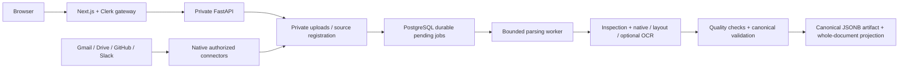

# FixFlow

FixFlow is currently a private document ingestion and parsing foundation. Upload or paste supported content, or synchronize owner-selected resources through Gmail, Google Drive, GitHub, and Slack. Processing stops at validated canonical document output.

The previous OKF generation, chunking, embeddings, keyword/dense retrieval, and local AI answer stages have been removed. Existing conversations and saved findings remain readable; this checkout does not create new answers. The next product objective has not been selected.

See [the module and data-flow audit](docs/product-reset.md), [the file inventory](docs/project-file-inventory.md), and [the parsing contract](docs/ingestion-pipeline.md).

## Architecture



Account ownership, connector permissions/leases, raw uploads, persistent parsing jobs, PostgreSQL, Clerk authentication, theme/layout, history, and saved snapshots remain. Historical database tables/columns and migrations remain to preserve existing data; they are not active processing features.

## Native setup

Use the existing `myenev` when present. Keep secrets private; copy examples only when the destination file does not already exist.

```bash
npm ci
python3 -m venv myenev  # only if absent
myenev/bin/python -m pip install -r requirements-dev.txt
# If absent: copy .env.example to .env.local, backend/.env.example to backend/.env.
# Configure PostgreSQL, Clerk, matching FIXFLOW_API_TOKEN, and the fixed public origin.
myenev/bin/alembic upgrade head
npm run dev:local
```

The initialized local PostgreSQL helper supports `bash scripts/local_postgres.sh start|status|stop`. It uses a Unix socket and port 55432 and does not initialize a new cluster. Alternatively use configured PostgreSQL or `docker compose up -d --wait db`.

For separate processes:

```bash
myenev/bin/python -m uvicorn backend.main:app --reload --host 127.0.0.1 --port 8000
npm run dev
```

Production native startup uses `npm run build` followed by `npm run start:local`, or separate FastAPI and `npm run start` processes. The launcher starts the application services only; no model server or inference warm-up remains. `python -m scripts.check_launch` performs a secret-free, read-only configuration/schema preflight.

## Docker

Configure root `.env` from `.env.example` without overwriting existing credentials, then run `docker compose up -d`. The order remains healthy database → migration → backend → frontend. No model overlay/relay remains. Preserve existing DB/upload volumes; never use `docker compose down -v` unless deliberately erasing them.

Migration `0006` adds the `parsed` terminal state and preserves all records. Existing application databases must be upgraded before this checkout processes uploads. No automatic bulk reprocessing occurs. Re-upload/update explicitly to replace an older artifact with the current parsing contract. Older chunk/vector rows remain stored and unused.

## Supported parsing

Native adapters cover PDF text/layout, DOCX/PPTX/XLSX, HTML/Markdown/text, CSV/JSON/XML/YAML, supported source code, logs, email, and text transcripts. Scans/images require configured native Tesseract/Poppler OCR. Audio/video require an explicitly installed trusted transcription adapter; none is supplied. Difficult PDF layout can fail safely with review required. Source content is data and is never executed.

Strict standalone OKF Markdown is retained as an **input parsing format**. The system does not generate OKF concepts/bundles. Canonical blocks represent document structure; they are not token-budget chunks and are not sent to a model.

```bash
myenev/bin/python -m scripts.run_pipeline path/to/file --out .local/parsed-export
```

The offline CLI exports only `pipeline.json`, with bounded execution, cache validation, and optional `--force`/`--strict-okf`. Production storage remains PostgreSQL.

## Checks

```bash
npm run lint
npm run typecheck
npm test -- --maxWorkers=1
npm run build
myenev/bin/python -m ruff check backend scripts
myenev/bin/python -m mypy backend scripts
# TEST_DATABASE_URL must name a separate disposable PostgreSQL database ending _test.
myenev/bin/python -m pytest
myenev/bin/alembic check
```

Without `TEST_DATABASE_URL`, database integration tests skip. Those tests reset only the supplied disposable database. Provider HTTP is mocked in connector tests; live OAuth consent, external event delivery, and live Clerk sign-in require separate verification. See [runtime readiness](docs/runtime-readiness.md) and [connector setup](docs/connectors.md).
