# FixFlow

FixFlow is a private workspace assistant with validated document parsing, project evidence search, and Grok workflows across selected connected apps. Upload or paste supported content, or synchronize owner-selected resources through Gmail, Google Drive, GitHub, and Slack. Parsing produces validated canonical output; selected sources can then be indexed as structure-aware passages.

The previous OKF/concept, legacy embedding and local inference stages remain removed. Existing conversations and saved findings remain readable. The new evidence stage defaults to PostgreSQL lexical search, with explicit optional Gemini hybrid search and single-call cited synthesis; it does not revive the historical chunk/vector runtime. See [evidence/vector setup](backend/README.md) and [Grok workflow setup, tools and limits](docs/workspace-agents.md).

See [the module and data-flow audit](docs/product-reset.md), [the file inventory](docs/project-file-inventory.md), and [the parsing contract](docs/ingestion-pipeline.md).

## Architecture

```mermaid
flowchart LR
  Browser --> Next[Next.js + Clerk gateway]
  Next --> API[Private FastAPI]
  API --> Registration[Private uploads / source registration]
  Providers[Gmail / Drive / GitHub / Slack] --> Connectors[Native authorized connectors]
  Connectors --> Registration
  Registration --> Queue[PostgreSQL durable pending jobs]
  Queue --> Worker[Bounded parsing worker]
  Worker --> Inspection[Inspection + native / layout / optional OCR]
  Inspection --> Quality[Quality checks + canonical validation]
  Quality --> Storage[Canonical JSONB artifact + whole-document projection]
  Storage --> OptIn[Explicit source + project assignment]
  OptIn --> Passages[Structure-aware passages + lexical search]
  Passages --> EmbeddingJobs[Optional durable embedding batches]
  EmbeddingJobs --> Vectors[pgvector + atomic source activation]
  Passages --> Evidence[Lexical / RRF hybrid evidence]
  Vectors --> Evidence
  Evidence --> Grok[Grok bounded function loop]
  Connectors --> Grok
  Grok --> Actions[Authorized Gmail outbox / private file tickets]
  Evidence --> Answer[Optional single cited answer call]
```



Account ownership, connector permissions/leases, raw uploads, persistent parsing jobs, PostgreSQL, Clerk authentication, theme/layout, history, and saved snapshots remain. Historical database tables/columns and migrations remain to preserve existing data; they are not active processing features.

## Workspace workflows

Use **Work with your workspace** on the home page. Ask a question, investigate connected evidence, request files or ask for an email draft/reply. The agent chooses among typed tools rather than a fixed sequence. [Setup and examples](docs/workspace-agents.md) explain the Grok key/model, migration `0010`, selected-resource scope and Gmail send consent. Backend placeholders are in `backend/.env`; secrets stay server-side.

The [prompt and security policy](docs/agent-security.md) adds versioned instructions, credential-egress checks, continuous tool/output validation and shared PostgreSQL quotas. Email tools require explicit permission for each run. Failed password/MFA lockout is handled by Clerk and must be verified in the deployed Clerk Dashboard.

Email defaults to a reviewable draft. Automatic sending requires an explicit per-request recipient policy and separately granted Gmail send scope. Uncertain delivery is never blindly retried. Google Workspace PDF exports and existing Drive/GitHub PDFs use private version-bound downloads. Existing lexical/hybrid search, source parsing and historical records remain available. Developer workflow guidance is in [SKILL.md](SKILL.md).

## Native setup

Use the existing `myenev` when present. Keep secrets private; copy examples only when the destination file does not already exist.

```bash
npm ci
python3 -m venv myenev  # only if absent
myenev/bin/python -m pip install -r requirements-dev.txt
# If absent: copy .env.example to .env.local, backend/.env.example to backend/.env.
# Configure PostgreSQL, Clerk, matching FIXFLOW_API_TOKEN, and the fixed public origin.
myenev/bin/alembic upgrade head
npm run dev:local
```

The initialized local PostgreSQL helper supports `bash scripts/local_postgres.sh start|status|stop`. It uses a Unix socket and port 55432 and does not initialize a new cluster. Alternatively use configured PostgreSQL or `docker compose up -d --wait db`.

For an opt-in two-replica backend with a private Nginx balancer and a separate
PostgreSQL runtime login, configure `POSTGRES_RUNTIME_PASSWORD` with a distinct
random 32–128 character URL-safe password, then use Docker Compose 2.24.4 or later:

```bash
docker compose -f compose.yaml -f compose.scale.yaml config --quiet
docker compose -f compose.yaml -f compose.scale.yaml up -d --build
```

Use this overlay only with a dedicated application database. Migrations retain
the owner credentials. A subsequent atomic provisioning step grants the runtime
login application DML and migration-version reads, without schema ownership,
DDL, truncation, role management or migration writes. It removes public database
connect/temporary-table privileges and public schema creation in that database;
other database clients need explicit grants. It refuses to repurpose an unmanaged,
elevated, member or object-owning login. Provision again after each migration. The native
administrative command is `myenev/bin/python -m scripts.provision_runtime`
(preview), or append `--apply` to apply the grants using the configured owner
connection and `POSTGRES_RUNTIME_USER` / `POSTGRES_RUNTIME_PASSWORD`. Passwords
reach PostgreSQL only as salted SCRAM verifiers. Database backups, restore tests,
host/disk security and TLS for remote database connections remain operator work.

The overlay removes database and backend host port bindings, routes the existing
Next gateway through Nginx, and shares the existing upload volume between both
backend replicas. Nginx updates Docker DNS addresses and uses least connections;
it never retries a forwarded request, because replaying a write could repeat an
external action. A failed in-flight request can return 502 before the failed peer
is excluded. Logs omit query strings and authorization headers. The default
two-replica pool allowance is 20 total backend connections, capped at 40 for the
runtime login; budget database connections before increasing replicas. This adds
backend balancing on one Docker host, not database/frontend high availability or
multi-host shared file storage. See the primary [PostgreSQL role guidance](https://www.postgresql.org/docs/current/role-attributes.html),
[Compose merge rules](https://docs.docker.com/reference/compose-file/merge/) and
[Nginx upstream documentation](https://nginx.org/en/docs/http/ngx_http_upstream_module.html).

For bounded local load proof, use an **empty, separate** PostgreSQL database ending
in `_test`, reachable on loopback TCP with SCRAM password authentication, and an
existing Nginx 1.28+ binary. The evaluator migrates this database, creates a
temporary restricted runtime login, starts two real backend processes and Nginx
on ports 8021–8023, measures direct/balanced requests at concurrency 1/8/24, tests
shared quotas, forged authentication, concurrent upload deduplication, parsing,
owner isolation and replica failure. It stops only its own services, removes its
temporary login, and retains test data and JSON/log proof under `.local`.

```bash
# Supply the disposable database URL privately in the environment.
myenev/bin/python -m scripts.load_test --nginx /absolute/path/to/nginx
```

It refuses non-loopback/non-test database names, connection query overrides,
occupied QA ports, and databases with any existing application rows. No provider/model credentials or live external calls are
used. These bounded measurements do not establish production throughput or an SLA.

For separate processes:

```bash
myenev/bin/python -m uvicorn backend.main:app --reload --host 127.0.0.1 --port 8000
npm run dev
```

Production native startup uses `npm run build` followed by `npm run start:local`, or separate FastAPI and `npm run start` processes. The launcher starts the application services only; no model server or inference warm-up remains. `python -m scripts.check_launch` performs a secret-free, read-only configuration/schema preflight.

## Docker

Configure root `.env` from `.env.example` without overwriting existing credentials, then run `docker compose up -d`. The order remains healthy database → migration → backend → frontend. No model overlay/relay remains. Preserve existing DB/upload volumes; never use `docker compose down -v` unless deliberately erasing them.

Migration `0006` adds the `parsed` terminal state and preserves all records. Existing application databases must be upgraded before this checkout processes uploads. No automatic bulk reprocessing occurs. Re-upload/update explicitly to replace an older artifact with the current parsing contract. Older chunk/vector rows remain stored and unused.

Migrations `0007`–`0009` add separate opt-in passage/index tables, source-scoped Gemini vectors and durable embedding jobs. Migration `0010` adds workspace runs, email actions and private file tickets. Review the migrations and apply through `head` before using this checkout; there is no automatic corpus backfill. Lexical search works without an API key. Optional hybrid search requires backend-only `GEMINI__API_KEY`, explicit preparation of source batches and selection of Hybrid mode. Evidence-only synthesis uses `EVIDENCE__API_KEY`/`EVIDENCE__MODEL`; workspace workflows use `GROK__API_KEY`/`GROK__MODEL`. Exact/latest/live facts require authorized native tools; unsupported operations are reported explicitly.

## Supported parsing

Native adapters cover PDF text/layout, DOCX/PPTX/XLSX, HTML/Markdown/text, CSV/JSON/XML/YAML, supported source code, logs, email, and text transcripts. Scans/images require configured native Tesseract/Poppler OCR. Audio/video require an explicitly installed trusted transcription adapter; none is supplied. Difficult PDF layout can fail safely with review required. Source content is data and is never executed.

Strict standalone OKF Markdown is retained as an **input parsing format**. The system does not generate OKF concepts/bundles. Canonical blocks represent document structure; they are not token-budget chunks and are not sent to a model.

```bash
myenev/bin/python -m scripts.run_pipeline path/to/file --out .local/parsed-export
```

The offline CLI exports only `pipeline.json`, with bounded execution, cache validation, and optional `--force`/`--strict-okf`. Production storage remains PostgreSQL.

## Checks

```bash
npm run lint
npm run typecheck
npm test -- --maxWorkers=1
npm run build
myenev/bin/python -m ruff check backend scripts
myenev/bin/python -m mypy backend scripts
# TEST_DATABASE_URL must name a separate disposable PostgreSQL database ending _test.
myenev/bin/python -m pytest
myenev/bin/alembic check
```

Without `TEST_DATABASE_URL`, database integration tests skip. Those tests reset only the supplied disposable database. Provider HTTP is mocked in connector tests; live OAuth consent, external event delivery, and live Clerk sign-in require separate verification. See [runtime readiness](docs/runtime-readiness.md) and [connector setup](docs/connectors.md).

For the complete frontend/backend/security evaluation, install Playwright separately from the application dependencies, provide its absolute package directory as `FIXFLOW_BROWSER_TOOLS` and a disposable PostgreSQL `TEST_DATABASE_URL` ending in `_test`, then run:

```bash
myenev/bin/python scripts/evaluate.py
```

The evaluator saves command results, JUnit, dependency audits, secret scans, browser screenshots/traces and real-stack database proof in `.local/evaluation/report.html`. It builds the application and uses test ports 4173, 3012 and 8012; it does not start or stop the normal application services. External Clerk identities are simulated only in the isolated browser build. See [the security evaluation and reproduction steps](docs/security-evaluation-2026-10-17.md) for the tested boundaries, findings and remaining limitations.
