# FixFlow

FixFlow is a private chat assistant for your uploads and selected Gmail, Google Drive, GitHub and Slack content. Connect apps once, choose the resources chat can read, then ask questions in the main prompt box. The assistant chooses relevant searches and reads automatically and returns answers with inspectable source quotations. Follow-ups continue the conversation; there is no workflow configuration or run button.

The previous OKF/concept, legacy embedding and local inference stages remain removed. Existing conversations and saved findings remain readable. The evidence stage supports PostgreSQL lexical search and optional Gemini hybrid search; it does not revive the historical chunk/vector runtime. See [evidence/vector setup](backend/README.md) and [assistant tools and limits](docs/workspace-agents.md).

See [the module and data-flow audit](docs/product-reset.md), [the file inventory](docs/project-file-inventory.md), and [the parsing contract](docs/ingestion-pipeline.md).

## Architecture

```mermaid
flowchart LR
  Browser --> Next[Next.js + Clerk gateway]
  Next --> API[Private FastAPI]
  API --> Registration[Private uploads / source registration]
  Providers[Gmail / Drive / GitHub / Slack] --> Connectors[Native authorized connectors]
  Connectors --> Registration
  Registration --> Queue[PostgreSQL durable pending jobs]
  Queue --> Worker[Bounded parsing worker]
  Worker --> Inspection[Inspection + native / layout / optional OCR]
  Inspection --> Quality[Quality checks + canonical validation]
  Quality --> Storage[Canonical JSONB artifact + whole-document projection]
  Storage --> OptIn[Explicit source + project assignment]
  OptIn --> Passages[Structure-aware passages + lexical search]
  Passages --> EmbeddingJobs[Optional durable embedding batches]
  EmbeddingJobs --> Vectors[pgvector + atomic source activation]
  Passages --> Evidence[Lexical / RRF hybrid evidence]
  Vectors --> Evidence
  Evidence --> Grok[Grok bounded function loop]
  Connectors --> Grok
  Grok --> Actions[Authorized Gmail outbox / private file tickets]
  Evidence --> Answer[Optional single cited answer call]
```



Account ownership, connector permissions/leases, raw uploads, persistent parsing jobs, PostgreSQL, Clerk authentication, theme/layout, history, and saved snapshots remain. Historical database tables/columns and migrations remain to preserve existing data; they are not active processing features.

## Workspace chat

Use **Ask your workspace** on the home page. Enter a question and press Enter or Send. Shift+Enter adds a newline. Authorized app selections and parsed uploads are included automatically; there is no per-message project or app switch. Open **Conversation History** to resume a chat, or **New chat** to start another. Questions and consulted source excerpts are sent to xAI. Selected resources, bounded search pages and last verified permissions determine coverage; an answer is not proof that every account item was reviewed.

Set backend-only `GROK__API_KEY` and `GROK__MODEL` to a function-capable model available to a funded xAI account. Missing keys, provider denials and limits produce an explicit failure without automatic paid retries or an alternate provider. Optional Gemini settings remain embeddings. The [prompt and security policy](docs/agent-security.md) retains versioned instructions, credential-egress checks, continuous tool/output validation and PostgreSQL quotas. Clerk handles sign-in and credential lockout.

New chat messages have no email action authority. Existing run/action APIs and historical email receipts remain compatible; previously prepared emails require their exact stored approval. Drive/GitHub file requests use private version-bound downloads. Durable assistant work continues internally across restarts so closing a tab does not discard a question. PostgreSQL stores chats; the browser is not their database. The model receives at most eight previous turns; the UI reopens the most recent twenty. Existing source parsing, optional lexical/hybrid indexes and historical saved records remain available.

### Connect and manually verify your apps

1. Start the configured local stack with `npm run dev:local`, then open `http://localhost:3000` and sign in.
2. Open **Connected Apps**. Expand **OAuth connection setup** on a card to see its exact callback URL, requested scopes and missing backend settings. Register that callback in the provider's developer console. Google needs the Gmail/Drive APIs and consent/test users; GitHub needs a read-only GitHub App installation; Slack needs user OAuth read scopes. [Provider setup](docs/connectors.md) lists the native requirements.
3. Connect the app, approve the provider consent, then **Configure resources**. Save the labels, folders/files, repositories or channels that chat can read. Saving starts durable synchronization automatically. Empty selections grant chat no account content. **Reconnect** refreshes authorization; **Check connection** tests native access.
4. Check **Knowledge Sources** for parsed snapshots. Ask a question about selected data in chat, open the cited sources, then ask a follow-up. Native reads can fetch selected resources while background synchronization continues. Slack limits may delay large histories.
5. For a repeatable check, upload a small note containing a distinctive fact, wait for **Parsed**, ask about that fact and inspect the quotation. A disconnected or unselected app must not contribute fresh evidence.

The local preflight checks configuration and schema only: `myenev/bin/python -m scripts.check_launch`. A successful preflight does not establish live consent, credits, model answer quality or commercial launch approval. A commercial launch still needs production Clerk keys, provider consent/publication approvals for the advertised audience, domain/TLS, privacy/retention terms and backup/restore verification. Google test-mode consent is not production verification.

Chat uses `POST/GET /api/chat/messages`, `GET /api/chat/messages/{id}` and `/{id}/thread`, and `POST /api/chat/messages/{id}/cancel`. Creation returns 202 after durable acceptance; the UI polls for the answer, stops after three refresh failures and offers manual refresh. Gateway authentication, owner filtering, source/native ACL checks and model/context/time budgets are retained. The older `/api/chat` remains retired.

## Native setup

Use the existing `myenev` when present. Keep secrets private; copy examples only when the destination file does not already exist.

```bash
npm ci
python3 -m venv myenev  # only if absent
myenev/bin/python -m pip install -r requirements-dev.txt
# If absent: copy .env.example to .env.local, backend/.env.example to backend/.env.
# Configure PostgreSQL, Clerk, matching FIXFLOW_API_TOKEN, and the fixed public origin.
myenev/bin/alembic upgrade head
npm run dev:local
```

The initialized local PostgreSQL helper supports `bash scripts/local_postgres.sh start|status|stop`. It uses a Unix socket and port 55432 and does not initialize a new cluster. Alternatively use configured PostgreSQL or `docker compose up -d --wait db`.

Slack requires an HTTPS OAuth callback, including during local development. Set
`CONNECTORS__PUBLIC_URL=https://localhost:3000` in the backend configuration and
the Next environment (`.env.local` overrides root `.env`), then run
`npm run dev:local`. Running `npm run dev` separately also detects this origin
and serves HTTPS. The backend gateway remains private HTTP on port 8000.
Add `https://localhost:3000` to `FRONTEND_ORIGINS` if using explicit CORS origins.

The development launcher creates and reuses a private certificate under
`.local/https/`; it does not install a system certificate authority or disable
TLS verification. Accept the localhost development certificate in your browser, then
open `https://localhost:3000` and sign in there. In your Slack app's
**OAuth & Permissions → Redirect URLs**, register exactly
`https://localhost:3000/api/connectors/slack/callback`. Register the HTTPS callback
URLs shown in Connected Apps for Google/GitHub too if using them on this origin.
An HTTP origin leaves Slack marked **Setup needed** and cannot start Slack OAuth.
Localhost supports browser OAuth redirects; external webhook delivery still
requires a reachable public HTTPS origin. Production HTTPS uses a TLS reverse
proxy; the development certificate is only for the native development launcher.

Gmail and Google Drive use the same Google OAuth project grant. Disconnecting one
immediately marks the matching connection for the same Google account and FixFlow
owner as requiring reconnection, wipes its credentials, cancels its active work,
and disables source access before remote revocation. That companion connection's
stored content is retained even if the selected connection is purged. Other Google
accounts and other FixFlow owners are not changed by the local disconnect action.

If a FixFlow session expires during provider consent, the callback redirects to
the prebuilt sign-in page without carrying its code or state. After signing in,
Connected Apps explains that a new connection must be started; an old callback
is never replayed under a different session. Normal signed-out API requests
still return 401, and callbacks still require an authenticated, matching owner.

OAuth failures use fixed categories for rejected client credentials, invalid or
expired codes, callback mismatches, scopes and denied access. Provider descriptions
and unknown error strings are never reflected in redirects, public errors or audit
details. Token exchanges and refresh requests use one HTTP attempt and never follow
redirects. A lost, malformed or ambiguous refresh response durably disables the old
credential and its source/workflow access until reconnection. Explicit rate-limit
rejections retain credentials for a later retry; ordinary reads keep bounded retries.

For an opt-in two-replica backend with a private Nginx balancer and a separate
PostgreSQL runtime login, configure `POSTGRES_RUNTIME_PASSWORD` with a distinct
random 32–128 character URL-safe password, then use Docker Compose 2.24.4 or later:

```bash
docker compose -f compose.yaml -f compose.scale.yaml config --quiet
docker compose -f compose.yaml -f compose.scale.yaml up -d --build
```

Use this overlay only with a dedicated application database. Migrations retain
the owner credentials. A subsequent atomic provisioning step grants the runtime
login application DML and migration-version reads, without schema ownership,
DDL, truncation, role management or migration writes. It removes public database
connect/temporary-table privileges and public schema creation in that database;
other database clients need explicit grants. It refuses to repurpose an unmanaged,
elevated, member or object-owning login. Provision again after each migration. The native
administrative command is `myenev/bin/python -m scripts.provision_runtime`
(preview), or append `--apply` to apply the grants using the configured owner
connection and `POSTGRES_RUNTIME_USER` / `POSTGRES_RUNTIME_PASSWORD`. Passwords
reach PostgreSQL only as salted SCRAM verifiers. Database backups, restore tests,
host/disk security and TLS for remote database connections remain operator work.

The overlay removes database and backend host port bindings, routes the existing
Next gateway through Nginx, and shares the existing upload volume between both
backend replicas. Nginx updates Docker DNS addresses and uses least connections;
it never retries a forwarded request, because replaying a write could repeat an
external action. A failed in-flight request can return 502 before the failed peer
is excluded. Logs omit query strings and authorization headers. The default
two-replica pool allowance is 20 total backend connections, capped at 40 for the
runtime login; budget database connections before increasing replicas. This adds
backend balancing on one Docker host, not database/frontend high availability or
multi-host shared file storage. See the primary [PostgreSQL role guidance](https://www.postgresql.org/docs/current/role-attributes.html),
[Compose merge rules](https://docs.docker.com/reference/compose-file/merge/) and
[Nginx upstream documentation](https://nginx.org/en/docs/http/ngx_http_upstream_module.html).

For bounded local load proof, use an **empty, separate** PostgreSQL database ending
in `_test`, reachable on loopback TCP with SCRAM password authentication, and an
existing Nginx 1.28+ binary. The evaluator migrates this database, creates a
temporary restricted runtime login, starts two real backend processes and Nginx
on ports 8021–8023, measures direct/balanced requests at concurrency 1/8/24, tests
shared quotas, forged authentication, concurrent upload deduplication, parsing,
owner isolation and replica failure. It stops only its own services, removes its
temporary login, and retains test data and JSON/log proof under `.local`.

```bash
# Supply the disposable database URL privately in the environment.
myenev/bin/python -m scripts.load_test --nginx /absolute/path/to/nginx
```

It refuses non-loopback/non-test database names, connection query overrides,
occupied QA ports, and databases with any existing application rows. No provider/model credentials or live external calls are
used. These bounded measurements do not establish production throughput or an SLA.

For separate processes:

```bash
myenev/bin/python -m uvicorn backend.main:app --reload --host 127.0.0.1 --port 8000
npm run dev
```

Production native startup uses `npm run build` followed by `npm run start:local`, or separate FastAPI and `npm run start` processes. The launcher starts the application services only; no model server or inference warm-up remains. `python -m scripts.check_launch` performs a secret-free, read-only configuration/schema preflight.

## Docker

Configure root `.env` from `.env.example` without overwriting existing credentials, then run `docker compose up -d`. The order remains healthy database → migration → backend → frontend. No model overlay/relay remains. Preserve existing DB/upload volumes; never use `docker compose down -v` unless deliberately erasing them.

Migration `0006` adds the `parsed` terminal state and preserves all records. Existing application databases must be upgraded before this checkout processes uploads. No automatic bulk reprocessing occurs. Re-upload/update explicitly to replace an older artifact with the current parsing contract. Older chunk/vector rows remain stored and unused.

Migrations `0007`–`0009` add separate opt-in passage/index tables, source-scoped Gemini vectors and durable embedding jobs. Migration `0010` adds durable assistant messages, historical email actions and private file tickets. Review the migrations and apply through `head` before using this checkout; there is no automatic corpus backfill. Lexical search works without an embedding key. Optional hybrid search requires backend-only `GEMINI__API_KEY` and explicit preparation of source batches. Chat chooses available retrieval automatically; Grok generation requires `GROK__API_KEY`/`GROK__MODEL`. The separate evidence-only API remains compatible with `EVIDENCE__API_KEY`/`EVIDENCE__MODEL`. Exact/latest/live facts require authorized native tools; unsupported operations are reported explicitly.

## Supported parsing

Native adapters cover PDF text/layout, DOCX/PPTX/XLSX, HTML/Markdown/text, CSV/JSON/XML/YAML, supported source code, logs, email, and text transcripts. Scans/images require configured native Tesseract/Poppler OCR. Audio/video require an explicitly installed trusted transcription adapter; none is supplied. Difficult PDF layout can fail safely with review required. Source content is data and is never executed.

Strict standalone OKF Markdown is retained as an **input parsing format**. The system does not generate OKF concepts/bundles. Canonical blocks represent document structure; they are not token-budget chunks and are not sent to a model.

```bash
myenev/bin/python -m scripts.run_pipeline path/to/file --out .local/parsed-export
```

The offline CLI exports only `pipeline.json`, with bounded execution, cache validation, and optional `--force`/`--strict-okf`. Production storage remains PostgreSQL.

## Checks

```bash
npm run lint
npm run typecheck
npm test -- --maxWorkers=1
npm run build
myenev/bin/python -m ruff check backend scripts
myenev/bin/python -m mypy backend scripts
# TEST_DATABASE_URL must name a separate disposable PostgreSQL database ending _test.
myenev/bin/python -m pytest
myenev/bin/alembic check
```

Without `TEST_DATABASE_URL`, database integration tests skip. Those tests reset only the supplied disposable database. Provider HTTP is mocked in connector tests; live OAuth consent, external event delivery, and live Clerk sign-in require separate verification. See [runtime readiness](docs/runtime-readiness.md) and [connector setup](docs/connectors.md).

For the complete frontend/backend/security evaluation, install Playwright separately from the application dependencies, provide its absolute package directory as `FIXFLOW_BROWSER_TOOLS` and a disposable PostgreSQL `TEST_DATABASE_URL` ending in `_test`, then run:

```bash
myenev/bin/python scripts/evaluate.py
```

The evaluator saves command results, JUnit, dependency audits, secret scans, browser screenshots/traces and real-stack database proof in `.local/evaluation/report.html`. It builds the application and uses test ports 4173, 3012 and 8012; it does not start or stop the normal application services. The root production-build gate rewrites `.next`, so run the complete evaluator before starting the normal production frontend. External Clerk identities are simulated only in the isolated browser build. See [the security evaluation and reproduction steps](docs/security-evaluation-2026-10-17.md) for the tested boundaries, findings and remaining limitations.

This runner checks software behavior and security. Its mocked provider/model responses do not measure live answer quality. Before evaluating the LLM, manually verify a real cited answer from each app you intend to use, a follow-up, history restoration and exclusion after removing access. Model credits, consent, resource selections and parsed data must work first.

Then freeze a small, approved test corpus and record reference questions, expected facts, source identities/versions and exact supporting quotations. Include questions requiring multiple apps, missing or conflicting evidence, follow-ups, revoked access and instructions embedded in source content. Score factual correctness, quotation/citation support, retrieval coverage and appropriate uncertainty separately; record end-to-end latency, model calls and token usage. Keep permission or credential failures as release blockers rather than averaging them into a quality score. A representative gold corpus and live answer-quality runner have not yet been supplied; no live accuracy score is claimed.
