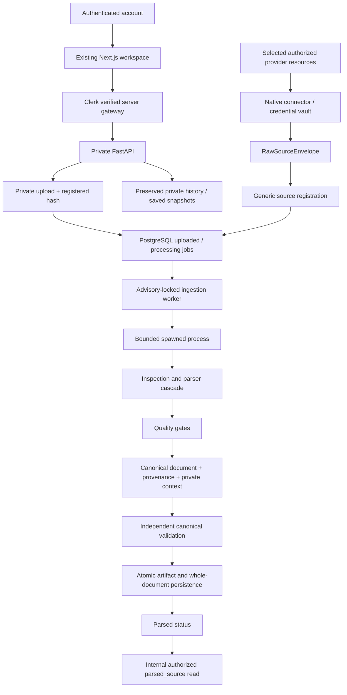

# Product reset and module/data-flow audit

Date: 2026-10-17. Requested boundary: preserve ingestion/parsing and the application foundation; remove the processing and AI features after parsing before choosing a clearer product objective.

The baseline inventory contained **284 tracked files: 266 text files and 18 binary assets/fixtures**. The repository-wide inventory/dependency scan covered source, configuration, migrations, tests, scripts, documentation and fixtures. Runtime call chains and affected contracts were traced before editing. Dependency trees, generated builds, private uploads, database internals and secret values are not product source and were excluded from the source audit. The [file inventory](project-file-inventory.md) records every baseline path and its disposition.

## What the old product did

The previous product mixed a debugging form, general questions, document ingestion, four external connectors, evidence search, local answer generation, history and saved findings. Those were separate features with different readiness/quality requirements, which made the product promise broader than any one validated user workflow.

It did **not** only chunk Markdown. All supported document/code/data parsers produced canonical structure; the old system then generated Markdown OKF concepts, built token-budget chunks and optionally generated vectors. Keyword or dense retrieval selected chunks, and an optional local generator produced cited answers. The Markdown concept representation was an intermediate generated format, not the universal original input format.

```mermaid
flowchart LR
  Inputs[Uploads / paste / authorized connectors] --> Parse[Inspection and parsing]
  Parse --> Canonical[Canonical document]
  Canonical --> OKF[Generated OKF concepts]
  OKF --> Chunks[Chunks and continuations]
  Chunks --> Vectors[Optional embeddings]
  Chunks --> Retrieval[Keyword / dense retrieval]
  Vectors --> Retrieval
  Retrieval --> Answers[Optional local cited answers]
  Answers --> Snapshots[Sessions / messages / saved findings]
```

## Module responsibilities and handoffs

Paths in this table refer to the repository root. Removed paths describe the baseline architecture.

| Module | Responsibility and data handoff | Disposition |
| --- | --- | --- |
| `src/app/layout.tsx`, `src/proxy.ts`, sign-in/sign-up routes | Clerk/session protection, theme/toast providers, account entry | Retained |
| `src/components/layout/*`, `src/components/ui/*`, CSS/images | Shared navigation, responsive shell, theme and UI controls | Retained; small capability-copy changes |
| `src/app/page.tsx`, debug input/result/chat components | Previously submitted questions/debug context; now restore/render/export/save historical snapshots, with removed actions disabled | Layout retained; new-answer path removed |
| `src/app/sources/page.tsx`, `src/lib/{files,sources}.ts` | File/paste selection → multipart registration; source status polling/refresh and manual activation | Retained; parsed terminal status and no embedding retry |
| History/saved/settings pages | Read account snapshots, export references, inspect runtime/source status | Retained; accurate parsing-only status |
| Connector page/components, `src/lib/{connectors,connector-contracts}.ts` | Provider/account discovery, selection, sync progress, health and disconnect | Retained |
| `src/lib/api.ts`, `response-validation.ts`, `types.ts` | Same-origin requests, timeouts, explicit domain contracts and receipt validation | Retained; retired mutation clients removed, parsing/access fields synchronized |
| Next backend gateway and origin helpers | Verify Clerk → overwrite trusted owner/secret → stream bounded request to FastAPI | Security/routing retained; ordinary deadline restored |
| Next connector callback/event routes | Fixed server callback origin and public event forwarding without trusted gateway identity | Retained |
| `backend/main.py`, API middleware, `services/access.py` | Trusted gateway authentication/body limits/CORS/safe errors; worker lifecycle | Retained; embedding worker and generation exception adapter removed |
| `backend/api/routes.py` | Sources/upload/status, owner-scoped history/messages/saved/readiness | Retained; ask/debug/chat/embedding retry return 410 without writes |
| `backend/services/uploads.py` | Validate signatures/names/UTF-8/size → private generated upload path/hash | Retained |
| `backend/services/ingestion.py` | PostgreSQL pending job → advisory lock → trusted source context → bounded parser process → transactional output | Retained; terminal `parsed`, no downstream processing |
| `pipeline/inspection.py` | Payload/modality/archive inspection and parser routing evidence | Retained |
| `pipeline/parsers.py` | Native documents/Office/code/structured data/email; geometric PDF layout; optional installed OCR | Retained |
| `pipeline/structure.py` | Conservative source declaration evidence and safe YAML tree validation formerly shared with splitting | Extracted parsing helpers only; no splitter |
| `pipeline/canonical.py` | Quality measurements → ordered blocks/sections/assets/relationships/provenance | Retained |
| `pipeline/context.py`, `validation.py` | Normalize source scope/private owner evidence; revalidate canonical content/identities/provenance/hashes | Retained, canonical-only |
| `pipeline/runner.py`, `execution.py` | Versioned orchestration/cache; spawned process/deadline/memory/output limits | Retained; contract 3 / engine 3.0.0 |
| `processing/okf.py` | Safely parse standalone uploaded OKF frontmatter/body and source YAML mappings | Retained as input support only |
| `pipeline/{concepts,chunks,units,splitting}.py`, legacy `processing/chunking.py` | Generated concepts/OKF, semantic/structural splitting, atomic slices/continuations, chunk validation | Deleted; only parser-required helpers moved to `structure.py` |
| Legacy loaders, corpus writer and JSONL importer | Alternative importer/chunk-writing route | Deleted; native parser route is authoritative |
| `repositories/pipeline.py` | Persist canonical JSONB plus one whole-document text projection, preserving unrelated/legacy rows | Retained and narrowed |
| `repositories/parsed.py` | SQL owner/status/availability/lease authorization → validated registered canonical artifact | New canonical-only replacement for removed prepared-chunk handoff |
| `repositories/{sources,source_access}.py` | Owner-scoped counts/lifecycle and SQL connection/ACL availability | Retained; access available independently from removed retrieval |
| `repositories/prepared.py` | Authorize/verify canonical-to-chunk/vector handoff | Deleted with chunk substrate |
| `services/{embeddings,embedding_profiles,ollama}.py`, vector repository | Remote/native embedding calls, formatting/model identity, vector persistence/search | Deleted |
| `services/{retrieval,retrieval_config}.py`, retrieval repository | Authorized keyword/dense lookup and answer-context expansion | Deleted |
| `services/{generation,diagnosis}.py` | Local structured answer inference, citation validation and diagnosis/provider abstraction | Deleted; historical input display helper stays with persisted schemas |
| `services/store.py` | Historical sessions/messages and independent saved JSONB snapshots | Retained without retrieval/provider/inference calls |
| `backend/connectors/{core,registry,config,http,base}.py` | Strict native connector interface, fixed-provider bounded HTTP/OAuth/downloads → raw envelope | Retained |
| `backend/connectors/{gmail,drive,github,slack}.py` | Provider-specific consent/discovery/selected incremental content and version identities | Retained |
| `backend/connectors/{vault,rates,events,subscriptions}.py` | Encrypted owner credentials/rotation, durable provider rates, verified events/watches | Retained |
| `services/{connectors,connector_sync,connector_sources}.py`, connector API/schemas | Lifecycle + durable jobs/checkpoints + raw envelope/source bridge + private asset cleanup/permission renewal | Retained; parsing contract upgrade check updated |
| `backend/db/{models,session}.py`, migrations | PostgreSQL identities, ownership, artifacts, historical snapshots and connector records | Retained; additive status migration `0006` |
| `scripts/{run_pipeline,check_launch,assign_legacy_owner}.py` | Canonical export, read-only preflight, explicit legacy ownership assignment | Retained; no generated bundle/model probe |
| Native start scripts / Dockerfiles / Compose | Application launch/build/storage/database migration dependencies | Retained; model starts/warm-up/relay/sidecar overlays removed |
| Backend/frontend/browser tests | Retained auth/connector/parsing/persistence/rendering tests; regression proof that removed actions/stages stay unavailable | Adapted; obsolete model/chunk benchmarks/harnesses deleted |
| Dependency lock / CI / tooling | Reproducible Python installs, frontend checks, source/test coverage mappings | Retained; unused LangChain/tokenizer dependencies removed |

## Current data flow

Provider adapters stop at `RawSourceEnvelope`; no provider credential/network logic is moved into parsing. The source row is the authority for application ownership. Canonical artifacts retain source locations and permission evidence, but native provider permission lists do not grant access to other FixFlow accounts. SQL owner/active/status/connection/lease checks precede canonical artifact decoding.

A 202 response means the source has been accepted. Parsing runs asynchronously and can fail safely. Status polling continues only for active pending parsing jobs and stops at `parsed`/`failed`. Failed updates retain prior valid parsed output; explicit reprocessing upgrades older artifacts without automatically processing the entire existing corpus.

## Removal and data preservation

- Removed generated OKF/concepts, chunking/splitters/continuations, remote/local embedding providers and workers, keyword/dense search, model answer synthesis, associated benchmarks/configuration/exports and obsolete inference harnesses.
- Removed local model tags `embeddinggemma:300m` and `qwen3:4b-instruct-2507-q4_K_M` using Ollama's model removal command. Inventory afterwards contained no tags in the user's model store; **3,119,178,463 bytes** were reclaimed. The shared Ollama executable was retained, and the temporary removal service was stopped.
- Removed corresponding non-secret settings from private native environment files without replacing credential/DB/Clerk/connector values. Removed unused LangChain/tokenizer packages from the project environment and dependency lock.
- Cleaned generated old test app copies and isolated vector benchmark files. Original uploads, credentials, DB/upload volumes, backups and independent history/saved records were preserved.
- Preserved migrations `0001`–`0005`, legacy database vector/chunk columns/table and persisted citation/answer schemas. They remain for storage/history compatibility, with no runtime generation/retrieval path. Pgvector remains required by historical migrations; removing that schema/data is a separate decision.
- Migration `0006` only extends the source-status constraint with `parsed`. It refuses unsafe downgrade while parsed rows exist. No bulk deletion, source relabeling or automatic backfill is part of the migration.
- Frontend routing/shell/theme and parsing/connector backend architecture remain. Necessary UI edits disable removed actions and correct labels/counters/status messages. Historical result/citation renderers remain for existing snapshots.

## Verification

| Executed check | Result |
| --- | --- |
| Full Python suite with disposable PostgreSQL and coverage | 261 passed; 2 native OCR tests skipped (Tesseract unavailable) |
| Frontend suite with coverage | 127 passed |
| Browser workspace and connector checks | 11 passed, including 320px/390px layouts and polling termination |
| Frontend lint / TypeScript / production build | Passed |
| Python Ruff / mypy / Bandit | Passed |
| Locked Python dependency audit | No known vulnerabilities found |
| Disposable database migrations and Alembic schema comparison | Passed; a single `0006` head |
| Existing local application DB migration | `0005 → 0006` after a private backup; row counts and content fingerprints unchanged in all 16 application tables; Alembic check passed |
| Read-only native launch preflight | All four local prerequisites passed |
| Local model removal inventory | Both project tags removed; no remaining tags in the user model store; temporary removal server stopped |

Backend integration tests use a separate disposable PostgreSQL database ending `_test`. Browser checks exercise actual React components with mocked gateway HTTP/Clerk/Next adapters; connector provider HTTP is mocked. These checks do not verify live Clerk sign-in, provider OAuth consent/event delivery, deployed infrastructure, backup restoration or native OCR. The two native OCR tests skip because Tesseract is unavailable. Historical model benchmarks no longer describe executable features.

Sanitized test reports/logs/screenshots are in ignored `.local/product-reset/` and `.local/browser-evidence/`. The private application backup is `.local/backups/parsing-reset-20261017-before-0006.dump`; no backup/environment/upload content is committed.

## Product decision still open

The reset preserves a usable input/parsing substrate and intentionally chooses no replacement AI workflow. Define the target user and recurring task, a bounded supported input set, the exact output/action, a measurable success threshold, and representative acceptance examples before adding the next stage. The canonical handoff provides source ownership, content structure and provenance for that decision without requiring the former RAG architecture.
